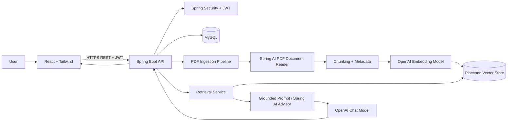

# ProspectAI — Architecture

## 1. Overview
ProspectAI is a modular full-stack application. React and Tailwind CSS provide the UI. Spring Boot exposes REST APIs, secures resources with JWT, orchestrates document ingestion and RAG, and persists application metadata in MySQL. Spring AI integrates the PDF reader, embedding model, chat model, and Pinecone vector store.

## 2. System Context



## 3. Technology Choices
- **Frontend:** React, Vite, Tailwind CSS, React Router.
- **Backend:** Java, Spring Boot, Spring Web, Bean Validation, Spring Security.
- **AI orchestration:** Spring AI.
- **PDF reading:** Spring AI PDF Document Reader module; choose the reader implementation appropriate for page-aware extraction.
- **LLM and embeddings:** OpenAI API through Spring AI.
- **Vector database:** Pinecone through Spring AI's vector-store integration.
- **Relational database:** MySQL with Spring Data JPA.
- **Build tools:** Maven and npm.
- **Deployment:** Docker is optional for local development and production packaging.

Confirm compatible versions and exact dependency coordinates from the current official Spring AI documentation before implementation.

## 4. Backend Package Structure

```text
com.prospectai
├── ProspectAiApplication.java
├── config/
│   ├── SecurityConfig.java
│   ├── JwtConfig.java
│   ├── CorsConfig.java
│   ├── AiConfig.java
│   └── PineconeConfig.java
├── security/
│   ├── JwtAuthenticationFilter.java
│   ├── JwtService.java
│   ├── CustomUserDetailsService.java
│   └── AuthEntryPointJwt.java
├── auth/
│   ├── AuthController.java
│   ├── AuthService.java
│   └── dto/
├── user/
│   ├── User.java
│   ├── Role.java
│   └── UserRepository.java
├── document/
│   ├── DocumentController.java
│   ├── DocumentService.java
│   ├── UploadedDocument.java
│   ├── DocumentRepository.java
│   ├── DocumentStatus.java
│   └── dto/
├── ingestion/
│   ├── PdfIngestionService.java
│   ├── PdfReaderService.java
│   ├── DocumentChunkingService.java
│   └── DocumentMetadataService.java
├── chat/
│   ├── ChatController.java
│   ├── ChatService.java
│   ├── ChatHistoryService.java
│   ├── ChatConversation.java
│   ├── ChatMessage.java
│   └── dto/
├── analysis/
│   ├── RhpAnalysisService.java
│   ├── FinancialAnalysisService.java
│   ├── RiskAnalysisService.java
│   └── AnalysisResponse.java
├── exception/
└── common/
```

### Layer Responsibilities
- **Controller:** HTTP mapping, input validation, response status; no business logic.
- **Service:** business rules and orchestration.
- **Repository:** MySQL persistence.
- **DTO:** API request/response contracts; do not expose JPA entities directly.
- **Config:** framework and infrastructure configuration.
- **Exception:** centralized, safe error mapping.

## 5. Frontend Structure

```text
src/
├── assets/
├── components/
│   ├── common/
│   ├── auth/
│   ├── documents/
│   ├── chat/
│   └── analysis/
├── pages/
├── services/
├── context/
├── hooks/
├── layouts/
├── utils/
├── App.jsx
├── main.jsx
└── index.css
```

- `pages/`: route-level screens.
- `components/`: reusable UI.
- `services/`: API calls only.
- `context/`: authentication state.
- `hooks/`: reusable stateful logic.
- `layouts/`: authenticated and public shells.
- `utils/`: pure helpers and validation.

## 6. Data Model
### User
- `id`
- `name`
- `email` (unique)
- `passwordHash`
- `role`
- `createdAt`

### UploadedDocument
- `id` (stable UUID recommended)
- `ownerId`
- `originalFilename`
- `companyName` (optional)
- `status` (`UPLOADED`, `PROCESSING`, `READY`, `FAILED`, `DELETING`)
- `pageCount` (optional)
- `createdAt`
- `updatedAt`
- `failureCode` or safe error summary (optional)

### ChatConversation
- `id`
- `ownerId`
- `documentId`
- `title` (optional)
- `createdAt`

### ChatMessage
- `id`
- `conversationId`
- `role`
- `content`
- `createdAt`
- citations may be stored as structured JSON or a related entity.

## 7. Ingestion Flow
1. Authenticate request and validate upload.
2. Create document row with `UPLOADED` status.
3. Transition to `PROCESSING`.
4. Read the PDF with Spring AI PDF Document Reader.
5. Normalize text cautiously; do not destroy table layout or section headings.
6. Split content using configurable chunk size and overlap.
7. Attach metadata: `documentId`, `ownerId` where appropriate, `pageNumber`, `chunkIndex`, `section` if known, and a stable vector ID.
8. Upsert chunks through Spring AI's Pinecone vector store.
9. Verify successful ingestion and set status to `READY`.
10. On error, set `FAILED`, log a correlation ID, and make retry behavior explicit.

For long documents, process asynchronously. Make ingestion idempotent so retries do not create duplicate vectors.

## 8. Retrieval and Answer Flow
1. Authenticate user.
2. Load the requested document and verify ownership.
3. Validate question and conversation ownership.
4. Search Pinecone with a mandatory `documentId` filter; use `ownerId` as an additional filter if appropriate.
5. Retrieve a configurable top-k set of relevant chunks.
6. Optionally apply a similarity threshold or reranking after evaluation.
7. Pass retrieved context and the user's question to the chat model through Spring AI.
8. Ask the model to answer only from context and admit when context is insufficient.
9. Build citations from retrieved chunk metadata, not from model-invented page numbers.
10. Return answer, citations, and conversation identifiers.

## 9. Security Architecture
- Use Spring Security with a JWT authentication filter.
- Hash passwords using BCrypt or another approved adaptive password encoder.
- Validate token signature, expiry, issuer/audience if configured, and required claims.
- Use short-lived access tokens. If refresh tokens are implemented, define rotation and revocation.
- Never store signing secrets or provider API keys in frontend code or Git.
- Enforce document ownership on every read, chat, analysis, and delete operation.
- Use a Pinecone namespace or metadata filters as an isolation aid, not as a substitute for backend authorization.
- Configure CORS for known frontend origins.
- Add upload size/type limits and safe error responses.

## 10. API Contracts
- `POST /api/auth/register`
- `POST /api/auth/login`
- `GET /api/users/me`
- `POST /api/documents/upload`
- `GET /api/documents`
- `GET /api/documents/{documentId}`
- `DELETE /api/documents/{documentId}`
- `POST /api/chat/{documentId}`
- `GET /api/chat/{conversationId}/history`
- `GET /api/analysis/{documentId}/overview`
- `GET /api/analysis/{documentId}/risks`

## 11. Failure Handling
- Invalid PDF: return a clear 4xx error.
- Ingestion provider failure: mark document `FAILED`, preserve safe diagnostics, and support retry.
- No relevant chunks: return a grounded “not found in this RHP” response.
- LLM/Pinecone outage: return a controlled 5xx response and correlation ID.
- Partial deletion: mark `DELETING` or cleanup-pending and retry vector cleanup.
- Invalid/expired JWT: return 401.
- Authenticated but unauthorized resource: return 403 or a consistent 404 policy that avoids revealing resource existence.

## 12. Deployment Topology
For a simple deployment, host the React static frontend, Spring Boot API, MySQL, and Pinecone separately. Keep provider secrets in backend environment configuration. Use HTTPS in production. Docker Compose may be used locally for the backend and MySQL; Pinecone and OpenAI remain managed external services.
